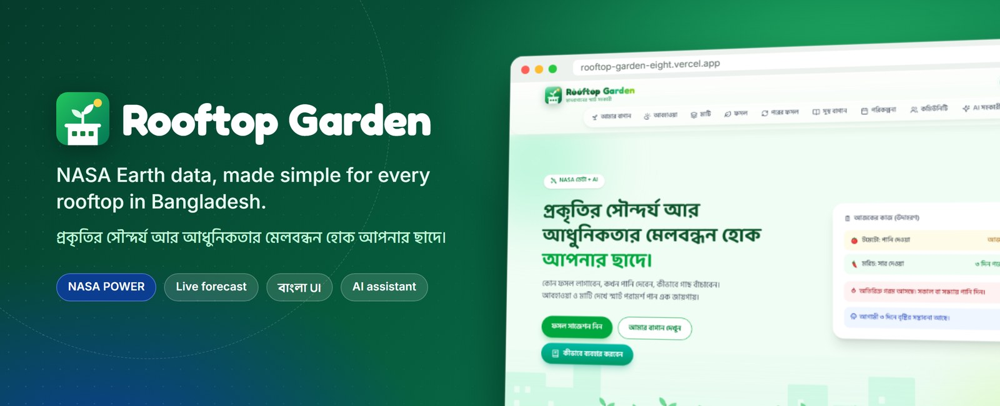
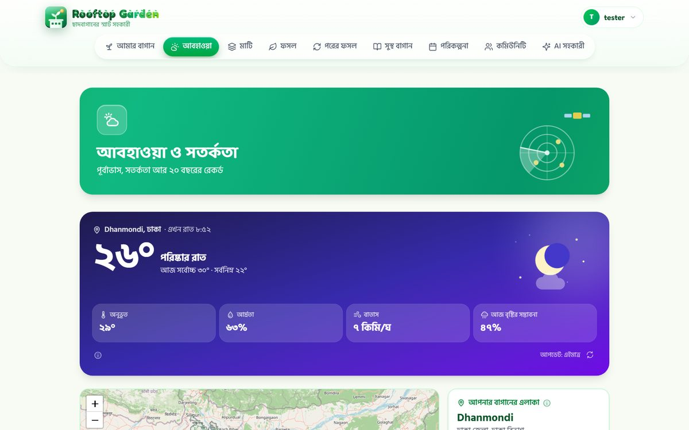
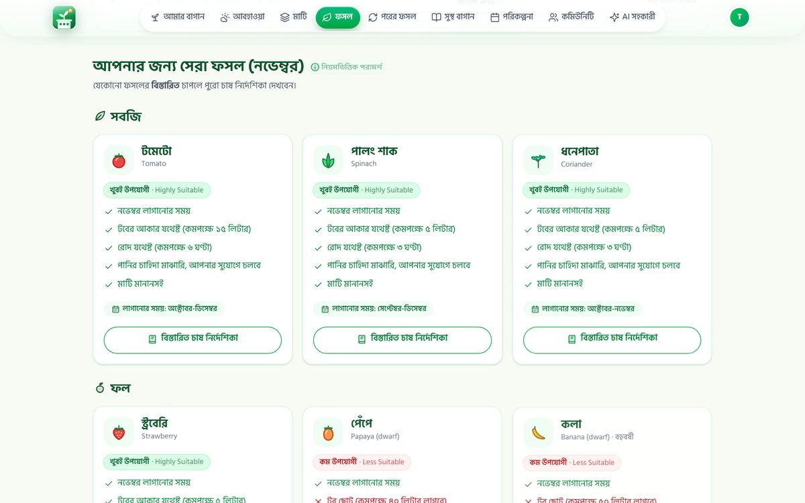
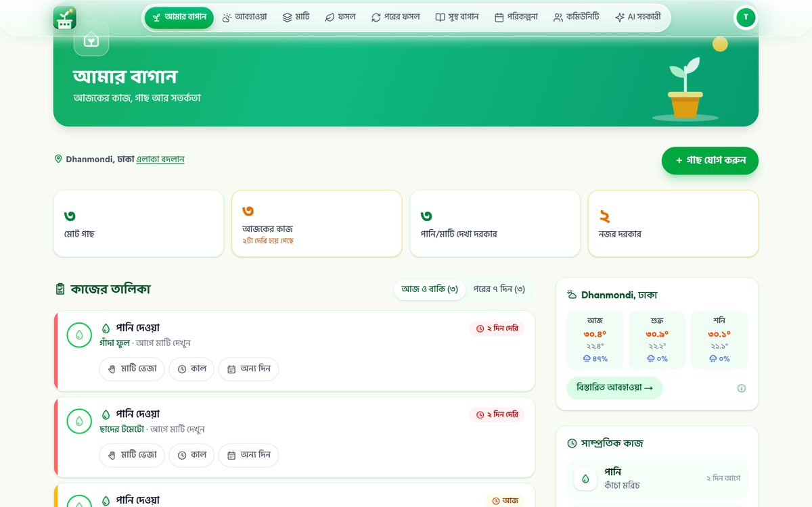
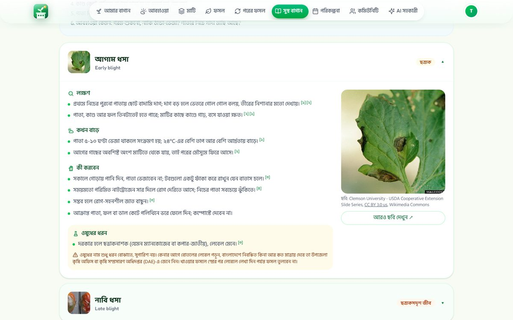
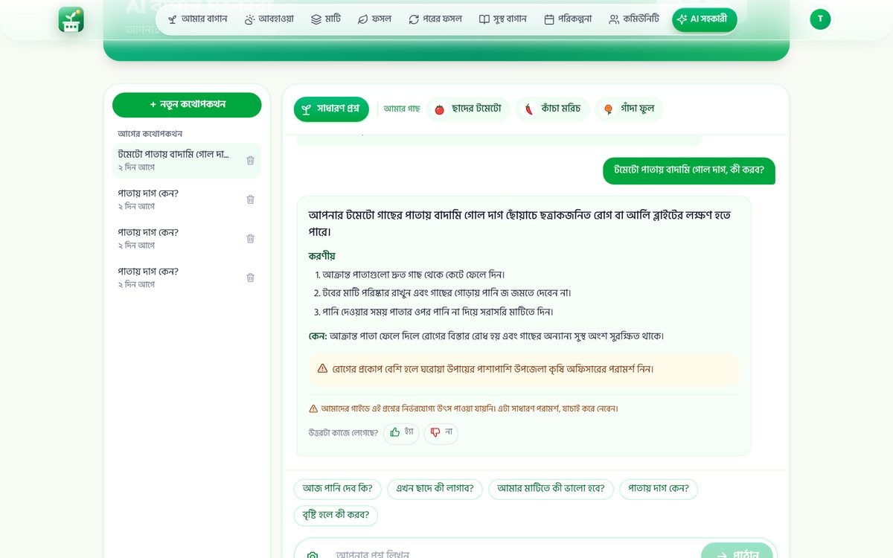
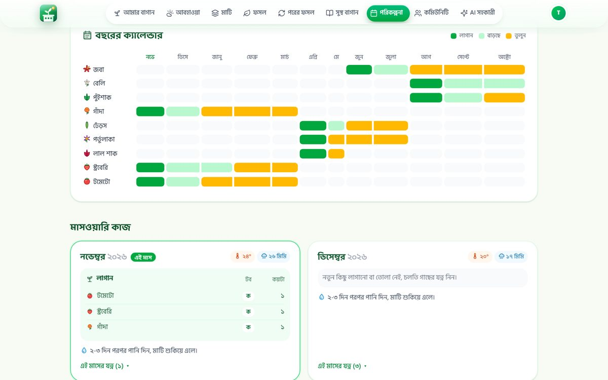
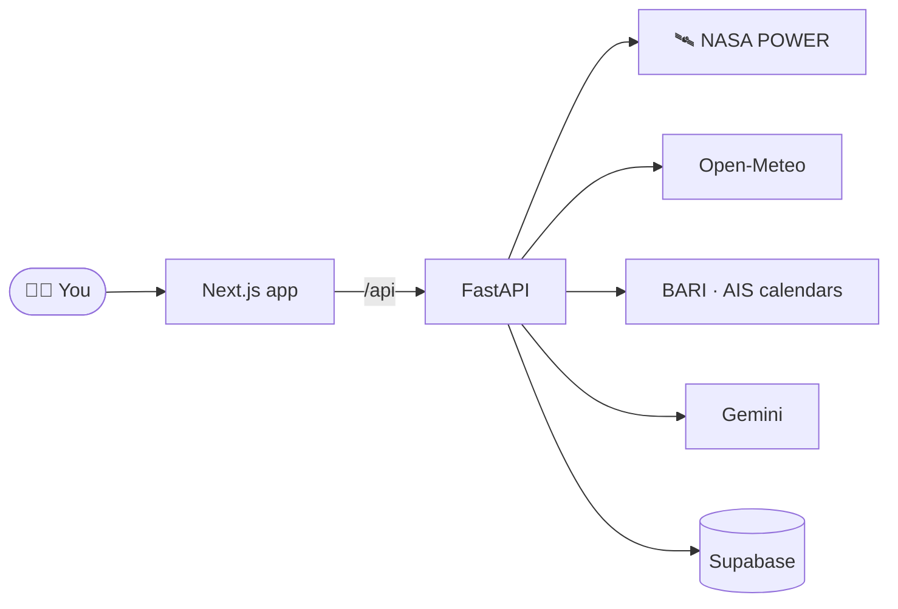

<div align="center">



<br>

**[🌐 Live site](https://rooftop-garden-eight.vercel.app)** &nbsp;·&nbsp; **[🛰️ NASA data](#-nasa-data-behind-it)** &nbsp;·&nbsp; **[⚙️ Run locally](#-run-it-locally)** &nbsp;·&nbsp; **[👥 Team](#-team)**


</div>

## 🌆 Why

Dhaka has little open ground but millions of rooftops. Families plant tomatoes and chillies there, and most give up within one season, because a roof is one of the hardest places to grow:

<div align="center">

| 🔥 April | 🌧️ July | 📈 Swing |
|:---:|:---:|:---:|
| **42.5 °C**<br><sub>hottest days, air temperature</sub> | **~404 mm**<br><sub>rain in one month</sub> | **40×**<br><sub>more rain than January (~10 mm)</sub> |

<sub>NASA POWER Climatology 2001–2025, Dhaka (23.81°N, 90.41°E): `T2M_MAX`, `PRECTOTCORR`</sub>

</div>

A pot that needs water twice a day in April can drown in July, and most advice online is written for other countries.

## 🌱 What it does

Pick your upazila, tell us your pots, soil and sun. Rooftop Garden turns NASA climate data, a live forecast and official Bangladeshi planting calendars into simple daily advice, in Bangla.

<table>
<tr>
<td width="50%" valign="top">
<br>
<b>🌦️ Weather & alerts</b><br>
<sub>A live card for your area, rain-soon warnings, a 5-day forecast and this week vs. the last 5 years.</sub>
</td>
<td width="50%" valign="top">
<br>
<b>🌱 What to grow now</b><br>
<sub>Crops ranked for your month, soil, pot size, sun and watering, with a to-scale pot guide.</sub>
</td>
</tr>
<tr>
<td valign="top">
<br>
<b>🪴 My Garden</b><br>
<sub>Your plants and today's tasks; reminders shift when heat, wind or rain is coming.</sub>
</td>
<td valign="top">
<br>
<b>🩺 Healthy Garden</b><br>
<sub>72 diseases and pests across 37 rooftop crops, with photos and safe, non-chemical first steps.</sub>
</td>
</tr>
<tr>
<td valign="top">
<br>
<b>🤖 AI assistant</b><br>
<sub>Ask in Bangla or English; get clear steps that know your plants and local weather.</sub>
</td>
<td valign="top">
<br>
<b>📅 1-year plan</b><br>
<sub>A month-by-month planting calendar for all your pots.</sub>
</td>
</tr>
</table>

<sub>Also: home soil tests (hand-feel and jar test), crop rotation, organic fertilizer and home-remedy guides, and a community feed.</sub>

## 🛰️ NASA data behind it

| Dataset | Parameters | Used for |
|---|---|---|
| [NASA POWER · Daily](https://power.larc.nasa.gov/docs/services/api/temporal/daily/) | `T2M` `T2M_MAX` `T2M_MIN` `RH2M` `ALLSKY_SFC_SW_DWN` | This week vs. the same week over 5 years, heat warnings |
| [NASA POWER · Climatology](https://power.larc.nasa.gov/docs/services/api/temporal/climatology/) 2001–2025 | `T2M` `PRECTOTCORR` `ALLSKY_SFC_SW_DWN` `GWETROOT` `RH2M` | What each month means for your roof, crop rotation |

<sub>Also used: <a href="https://open-meteo.com/">Open-Meteo</a> (live forecast, ERA5 history) · BARI and AIS planting calendars · <a href="https://www.geoboundaries.org/">geoBoundaries</a> upazila map · open-licence photos from Wikimedia Commons, Bugwood and USDA, credited in the app.</sub>



## ⚙️ Run it locally

<details>
<summary><b>Setup (Windows)</b>: Python 3.11+, Node.js 20+</summary>

```bat
cd backend
python -m venv venv
venv\Scripts\pip install -r requirements-dev.txt
copy .env.example .env
cd ..\frontend
npm install
cd ..
start.bat
```

Fill in `backend/.env` (at least `GEMINI_API_KEY` and `GOOGLE_CLIENT_ID`), then open http://localhost:3000. Tests: `backend\venv\Scripts\python -m pytest` from `backend/`; browser tests in [`e2e/`](e2e/README.md).

</details>

<details>
<summary><b>Tech stack</b></summary>

| | |
|---|---|
| Frontend | Next.js 16, React 19, Tailwind CSS 4, TypeScript, Leaflet |
| Backend | FastAPI, SQLAlchemy 2, Alembic |
| Data | SQLite locally, Supabase PostgreSQL in production |
| Login | Google sign-in → httpOnly session cookie |
| AI | Gemini free tier; falls back to our own guides when unavailable |
| Hosting | Vercel (`/api/*` → FastAPI, the rest → Next.js) |

</details>

<details>
<summary><b>Project structure</b></summary>

```
frontend/   Next.js app (app/ pages, components/)
backend/    FastAPI: weather.py (NASA POWER + Open-Meteo), crops.py, plan.py,
            rotation.py, chat.py, disease_diary.py, data/, tests/
e2e/        Playwright browser tests
tools/      data scripts
```

</details>

## 🤝 Honest notes

> [!NOTE]
> Crop, disease and remedy advice is drafted from official and university sources but **not yet reviewed by an agricultural expert**. That review, with partners like the Department of Agricultural Extension, is our next step. The AI can be wrong, and the app says so; heavy pest attacks are sent to the Upazila Agriculture Office (কৃষি কল সেন্টার 16123).

> [!TIP]
> **Use of AI tools.** We built this with help from AI coding assistants, **Claude (Anthropic)** and **ChatGPT (OpenAI)**; every change was reviewed, run and tested by the team. Inside the app, the chat uses Google Gemini. The story clips in our pitch video were made with Google Flow; the app demo is a real screen recording.

## 👥 Team

<div align="center">

| Sourav | Tanvir | Nahian | Mahmud | Bushara |
|:---:|:---:|:---:|:---:|:---:|
| Team lead | Developer<br>[@tanvie-01](https://github.com/tanvie-01) | Team member | Team member | Team member |

Built for the **NASA Space Apps Challenge 2026** · Bangladesh 🇧🇩

<sub>Climate data: NASA Langley Research Center POWER Project. Not endorsed by NASA.</sub>

</div>
